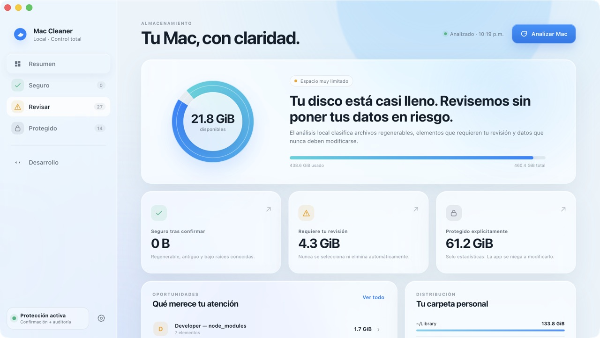
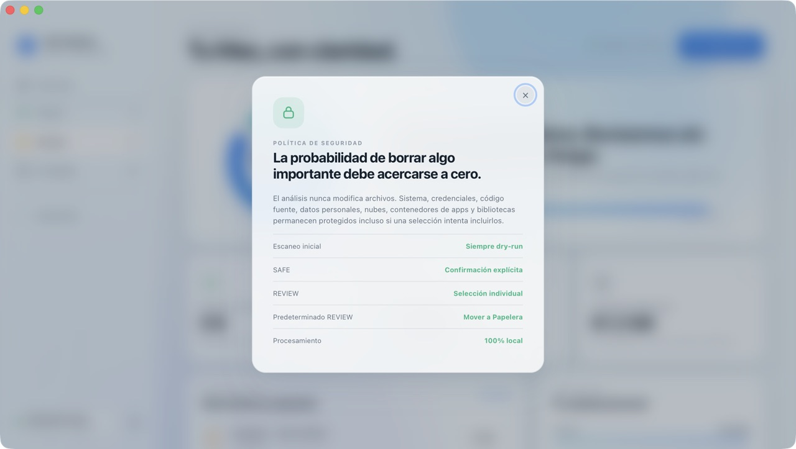

<p align="center">
  
</p>

<h1 align="center">Mac Cleaner Local</h1>

<p align="center">
  Analiza, entiende y recupera espacio en macOS sin convertir la limpieza<br />
  en una apuesta contra tus archivos importantes.
</p>

<p align="center">
  
  
  
  
  
</p>

---



## ¿Qué es?

**Mac Cleaner Local** es una aplicación de escritorio para macOS inspirada en las
funciones de limpieza de almacenamiento de CleanMyMac. Su propósito no es mostrar
la cifra más grande posible de “basura”, sino responder con claridad:

- ¿Dónde se está consumiendo el almacenamiento?
- ¿Qué archivos son regenerables y razonablemente seguros de limpiar?
- ¿Qué podría liberar mucho espacio, pero requiere una decisión humana?
- ¿Qué ubicaciones no debe tocar nunca un limpiador?

El análisis y el procesamiento ocurren en el Mac. No sube nombres de archivos,
rutas, hashes ni estadísticas a servicios externos.

## Diseñado alrededor de la seguridad

Cada resultado pertenece a una de tres categorías:

| Categoría | Significado | Comportamiento |
|:--|:--|:--|
| 🟢 **SAFE** | Datos antiguos y regenerables bajo raíces conocidas | Se muestran primero; limpiarlos requiere confirmación explícita |
| 🟠 **REVIEW** | Archivos potencialmente valiosos o costosos de reconstruir | Nada se preselecciona; el usuario elige cada elemento con un checkbox |
| ⚪️ **PROTECTED** | Datos personales, credenciales, código, apps o sistema | Solo estadísticas; la aplicación se niega a modificarlos |

> La regla principal es sencilla: ante una duda, SAFE se convierte en REVIEW;
> ante una ambigüedad importante, REVIEW se convierte en PROTECTED.



## Qué puede analizar

### Limpieza segura y regenerable

- Cachés antiguas de aplicaciones en `~/Library/Caches`.
- Logs de usuario y reportes de diagnóstico antiguos.
- Xcode DerivedData, documentación y module caches.
- Dispositivos de simulador que `simctl` marca como no disponibles.
- Elementos que el propio Homebrew identifica mediante `brew cleanup --dry-run`.
- Cachés de npm, pnpm y Python, reportadas conservadoramente cuando una limpieza
  oficial sería demasiado amplia para ejecutarla con confianza.

Los archivos recientes, abiertos, ajenos al usuario o modificados después del
análisis quedan fuera o son rechazados al confirmar.

### Elementos que siempre requieren revisión

- Downloads, instaladores, imágenes de disco y archivos comprimidos.
- Archivos grandes o antiguos. **Antiguo nunca significa inútil.**
- Backups locales de iPhone y iPad.
- Xcode Archives, Device Support y runtimes instalados.
- Imágenes, contenedores, volúmenes y build cache de Docker.
- Snapshots locales de Time Machine.
- Papelera.
- `node_modules`, `.venv`, `venv`, `.next`, `build`, `dist` y caches de Gradle.
- Duplicados confirmados mediante tamaño, hash parcial y SHA-256 completo.

Docker volumes, snapshots, runtimes y otras entradas sin una acción directa
inequívoca aparecen como información sin checkbox.

### Ubicaciones protegidas

La aplicación rechaza, entre otras:

```text
/System              /Library                 ~/.ssh
/bin                 /private                 ~/.aws
/sbin                /var                     ~/.config
/usr                 /Applications            archivos .env

Documents · Desktop · Fotos · Música · Mail · Messages · Safari
iCloud Drive · Dropbox · OneDrive · Google Drive
Library/Containers · Library/Group Containers · repositorios Git
aplicaciones .app · bibliotecas multimedia · credenciales
```

No modifica bundles firmados, no elimina arquitecturas de Universal Binaries y no
borra recursivamente directorios del sistema.

## Flujo de uso

1. Abre **Mac Cleaner Local**.
2. La aplicación ejecuta un análisis inicial de solo lectura.
3. Revisa el resumen y abre SAFE, REVIEW o PROTECTED para ver rutas exactas.
4. Para SAFE, inspecciona el plan y confirma la limpieza.
5. Para REVIEW, selecciona manualmente los archivos deseados.
6. Usa **Mover a Papelera** como opción normal. El borrado permanente está limitado
   a archivos regulares individuales y exige escribir `ELIMINAR`.
7. Tras una acción, el informe se invalida y debe generarse uno nuevo.

Mover algo a la Papelera no se contabiliza como espacio recuperado hasta que la
Papelera sea vaciada.

## Comprobaciones antes de cada acción

Justo antes de tocar un elemento, el ejecutor central vuelve a comprobar:

- dispositivo, inode, tamaño y fecha de modificación;
- propietario actual;
- ausencia de symlinks en toda la ruta;
- pertenencia a una raíz de limpieza permitida;
- clasificación y coincidencia exacta con el informe conservado por Tauri;
- exclusiones persistentes y directorios protegidos;
- que no sea `/`, el HOME del usuario ni una ruta sospechosamente amplia.

Las rutas nunca se concatenan en comandos de shell. Los directorios REVIEW solo se
mueven mediante un rename atómico a `~/.Trash`; no existe fallback de
copiar-y-borrar entre sistemas de archivos.

## Auditoría

Cada operación genera un registro JSON en:

```text
~/.local/share/mac-cleaner/history/
```

El registro incluye fecha, versión de macOS, acción, ruta original, tamaño,
categoría, motivo y resultado. El espacio recuperado se mide con el almacenamiento
disponible antes y después; no se afirma que se liberaron gigabytes sumando simples
estimaciones.

```console
./mac-cleaner history
```

## Aplicación de escritorio

La interfaz está construida con **Tauri 2 + HTML/CSS/JavaScript** y sigue una
estética nativa de macOS basada en capas translúcidas, profundidad, tipografía del
sistema y controles con jerarquía visual clara.

La build local queda disponible en:

```text
~/Applications/Mac Cleaner Local.app
```

También se genera un DMG para Apple Silicon en:

```text
src-tauri/target/release/bundle/dmg/Mac Cleaner Local_0.2.0_aarch64.dmg
```

> La build local utiliza firma ad-hoc y no está notarizada por Apple. Para
> distribución pública se necesita un certificado Developer ID y notarización.

## CLI

El motor Python también puede usarse desde Terminal. Ejecutar `mac-cleaner` sin
subcomando **nunca borra nada**.

| Comando | Función |
|:--|:--|
| `./mac-cleaner` | Resumen de almacenamiento, equivalente a `scan` |
| `./mac-cleaner scan --developer --large` | Análisis ampliado de desarrollo y archivos grandes |
| `./mac-cleaner scan --details` | Muestra cada ruta candidata |
| `./mac-cleaner large` | Archivos grandes y antiguos en ubicaciones acotadas |
| `./mac-cleaner duplicates` | Duplicados verificados, comenzando por Downloads |
| `./mac-cleaner clean --dry-run` | Plan SAFE exacto sin modificar archivos |
| `./mac-cleaner clean` | Limpieza SAFE interactiva; exige `LIMPIAR SEGURO` |
| `./mac-cleaner history` | Historial de auditorías |
| `./mac-cleaner ignore PATH` | Excluye permanentemente una ruta |

## Exclusiones y configuración

La configuración reside en:

```text
~/.config/mac-cleaner/config.json
```

Se pueden excluir rutas, patrones y categorías completas:

```console
./mac-cleaner ignore ~/Proyectos/cliente-importante
./mac-cleaner ignore --pattern '*.keep-cache'
./mac-cleaner ignore --category 'App caches'
```

Los umbrales de antigüedad, tamaño y límites de enumeración también son
configurables. Las exclusiones se aplican antes de crear candidatos de limpieza.

## Desarrollo

### Requisitos

- macOS 12 o posterior.
- Python 3.10 o posterior.
- Rust y Cargo.
- Node.js y npm.
- Tauri 2 CLI, instalado por las dependencias del proyecto.

No se instala ninguna dependencia automáticamente y el funcionamiento normal no
requiere `sudo`.

### Ejecutar y compilar

```console
npm install
npm run dev
npm run build
```

### Pruebas

```console
PYTHONPATH=src python3 -m unittest discover -s tests -v
cargo check --manifest-path src-tauri/Cargo.toml
node --check frontend/app.js
```

Las pruebas destructivas utilizan exclusivamente fixtures temporales. Incluyen
intentos contra `/`, HOME, `~/.ssh`, Documents, `/System`, cambios posteriores al
scan, escapes mediante symlinks y nombres con espacios, Unicode, saltos de línea,
metacaracteres y guiones iniciales.

## Arquitectura

```text
macOS + filesystem + herramientas nativas
                  │
                  ▼
        scanners Python de solo lectura
                  │
                  ▼
        informe inmutable con identidades
                  │
                  ▼
     estado sellado dentro del proceso Rust
             │                 │
             ▼                 ▼
       interfaz paginada   selección exacta
                                │
                                ▼
                   revalidación centralizada
                                │
                                ▼
                     acción + auditoría JSON
```

Consulta [ARCHITECTURE.md](./ARCHITECTURE.md) para conocer los límites de confianza
y las decisiones internas de seguridad.

---

<p align="center">
  <strong>Recuperar menos espacio es aceptable. Borrar algo importante no lo es.</strong>
</p>
