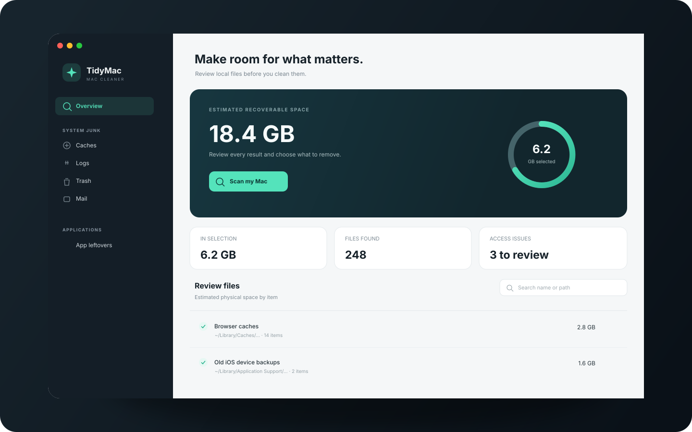
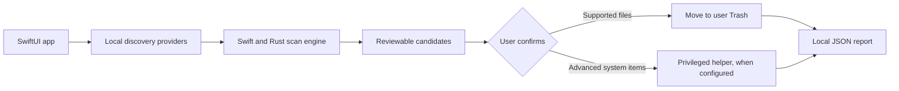

<div align="center">
  

  <h1>TidyMac</h1>
  <p><strong>A local-first Mac cleanup app that lets you inspect before you clean.</strong></p>
  <p>
    
    
    
    
  </p>
</div>

TidyMac is an experimental native macOS utility for finding reclaimable files across common system, app, Mail, download, and developer locations. It shows candidates and estimated space so you can review a selection before starting cleanup. The app works locally; it does not require a cloud account or upload scan results.

> TidyMac is an independent project and is not affiliated with or endorsed by Apple or MacPaw. It is not a copy of CleanMyMac. Cleanup behavior varies by category; read the confirmation text in the app before proceeding.

## What it can do

- Scan for caches, logs, temporary files, old downloads, Trash contents, Mail attachments, developer data, simulator files, and related application files.
- Review discovered paths, estimated sizes, categories, and access issues before cleanup.
- Search results, adjust selections, and add exclusions.
- Move supported items to the user's Trash so they can be restored before the Trash is emptied.
- Perform certain advanced or privileged cleanup actions only after an explicit confirmation. These actions can permanently remove data.
- Save cleanup reports locally for later review.
- Run in fixture mode against a temporary home directory for development.

The scan is best-effort: macOS privacy permissions and files in use can prevent access to some locations. Reported space is an estimate, nested paths are accounted for to avoid double counting, and not every discovered item is automatically safe to remove. Review each selection.

## How it works



Discovery and cleanup are separate steps. The app builds a candidate list first; cleanup runs only after the user selects items and confirms the action. The Rust library accelerates filesystem scanning, while Swift handles the macOS UI, discovery providers, cleanup coordination, and optional helper communication.

## Requirements

- macOS 26 or later
- Xcode Command Line Tools with Swift 6 and Swift Package Manager
- Rust toolchain with Cargo
- A Mac capable of building and running native macOS apps

The privileged helper is optional. Building and using the app without installing or authorizing that helper still allows supported user-level scans and cleanup. Full Disk Access may improve discovery coverage; grant it only if you want the app to inspect protected locations.

## Build

```bash
git clone https://github.com/m0rgAn115/Mac-cleaner-v2.git
cd Mac-cleaner-v2
./scripts/build.sh
open build/TidyMac.app
```

The build script compiles the Rust engine and Swift app, assembles `build/TidyMac.app`, and signs the local bundle with an ad-hoc signature by default. For a distributable app, configure an appropriate Apple signing identity and complete the required signing and notarization process yourself.

To run the test suites:

```bash
./scripts/test.sh
```

## Safe development run

Pass a temporary home directory to keep fixture-mode discovery away from your personal files:

```bash
fixture_home="$(mktemp -d)"
open build/TidyMac.app --args --fixture-home "$fixture_home"
```

Fixture mode writes app state inside that fixture directory. Remove it when finished:

```bash
rm -rf "$fixture_home"
```

Use only a directory you created for this purpose. The normal app mode scans the current user's Mac.

## Repository map

| Path | Purpose |
| --- | --- |
| `Sources/TidyMac/` | SwiftUI application and app model |
| `Sources/CleanerCore/` | Discovery, candidate modeling, cleanup, reports, and storage |
| `Sources/CleanerBridge/` | C bridge between Swift and the Rust library |
| `Sources/CleanerHelper/` | Optional privileged helper executable |
| `Sources/PrivilegedProtocol/` | Shared app/helper protocol |
| `engine/` | Rust filesystem scanning engine |
| `Tests/` | Swift test suite |
| `scripts/` | Build, test, and environment scripts |
| `docs/` | Implementation notes and coverage details |
| `reverse-eng/` | Research notes that informed parts of the cleanup catalog |

## Data and privacy

TidyMac performs discovery and cleanup on the Mac where it runs. Cleanup reports, exclusions, and optional Mail account metadata are stored locally under the user's Application Support directory. No analytics or remote service is required by the app.

Some categories require additional macOS access. The app can report locations it could not inspect. The optional privileged helper is a separate system component and must be correctly signed and approved by the user before privileged operations are available. Do not install a helper build you do not trust.

## Current status

This is an actively developed personal project. It is not a notarized consumer release, and the coverage of cleanup categories is still evolving. Review the project notes for implementation details:

- [Native engine and coverage notes](docs/NATIVE.md)
- [Privileged helper design](docs/PRIVILEGED.md)
- [Mail discovery coverage](docs/COVERAGE-MAIL.md)
- [Related files coverage](docs/COVERAGE-RELATED.md)
- [Provider coverage](docs/COVERAGE-PROVIDERS.md)
- [Advanced discovery coverage](docs/COVERAGE-ADVANCED.md)

## License

No license has been specified yet. Unless a license is added to this repository, all rights are reserved and reuse, redistribution, and modification are not granted by default.
